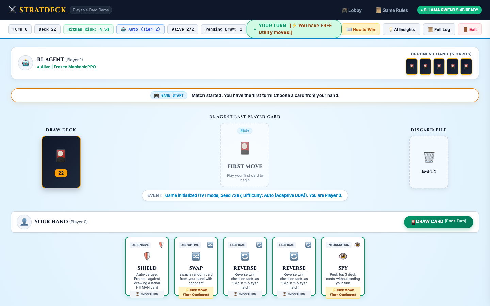
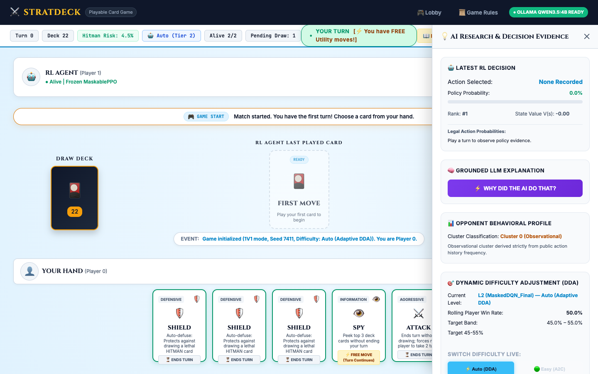
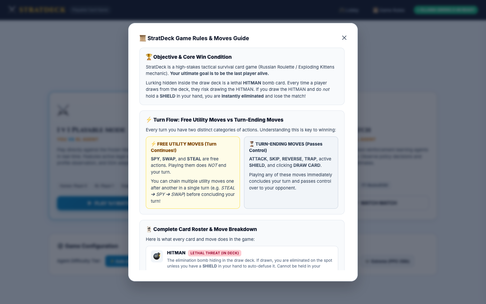
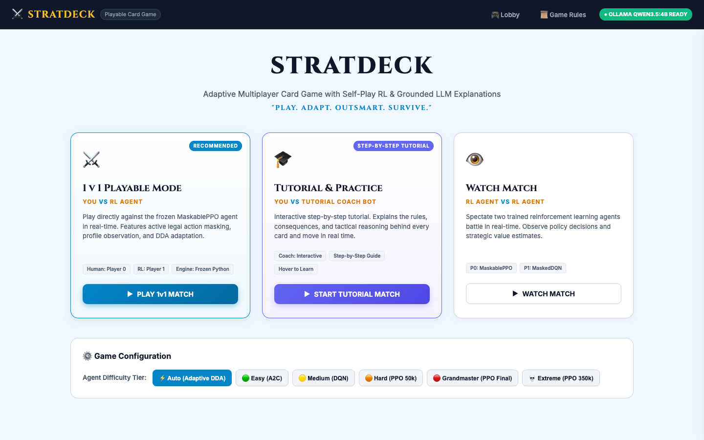
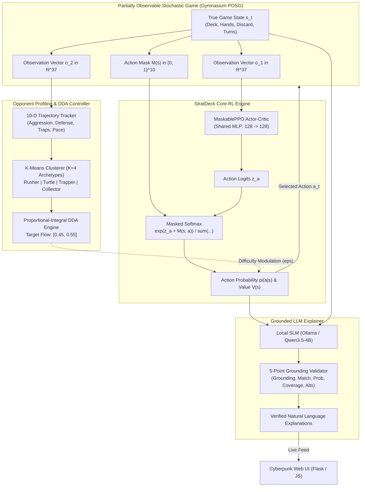
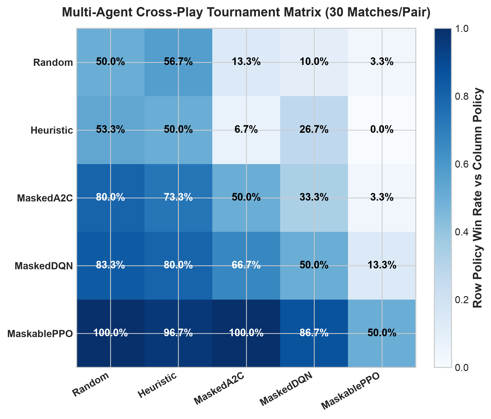
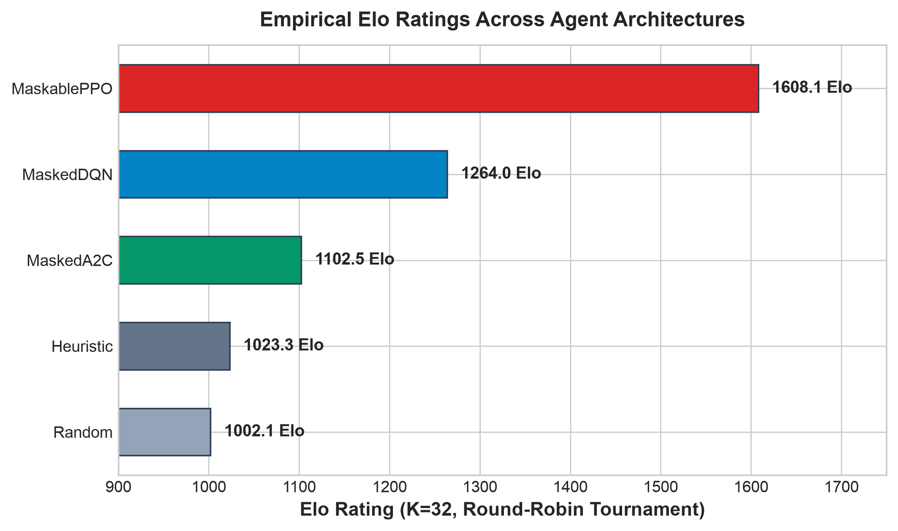
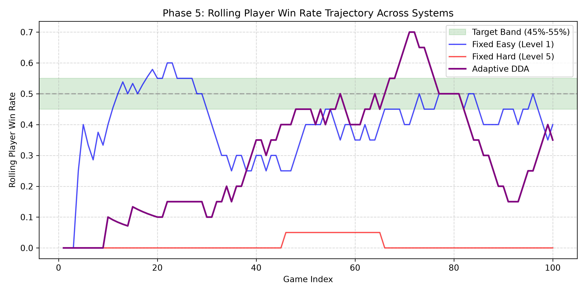
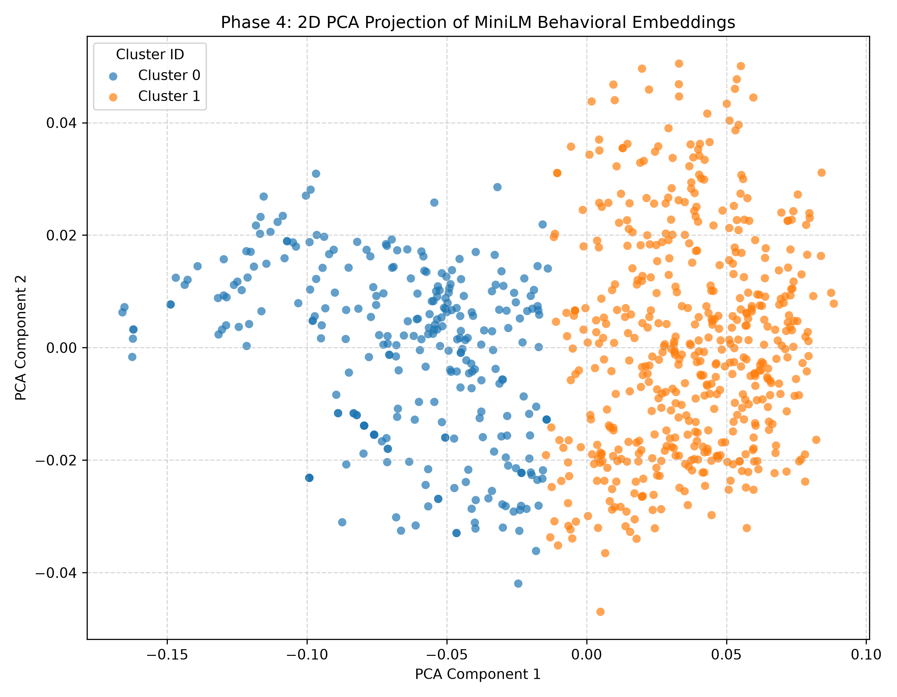

<div align="center">

# 🎴 StratDeck

### Profile-Aware Dynamic Difficulty Adjustment with Masked Self-Play PPO for Imperfect-Information Card Games

[](https://www.python.org/)
[](https://pytorch.org/)
[](https://gymnasium.farama.org/)
[](https://sb3-contrib.readthedocs.io/)
[](https://flask.palletsprojects.com/)
[](https://ollama.com/)
[](tests/)
[](LICENSE)

*An end-to-end framework integrating deep reinforcement learning, unsupervised behavioral opponent profiling, closed-loop dynamic difficulty adjustment (DDA), and verifiable explainable AI (XAI) within a partially observable imperfect-information card game.*

---

</div>

## 📌 Table of Contents
1. [Overview & Research Motivation](#-overview--research-motivation)
2. [Interactive UI Showcase](#-interactive-ui-showcase)
3. [System Architecture](#-system-architecture)
4. [Game Environment & Mechanics](#-game-environment--mechanics)
5. [Reinforcement Learning & Masked Self-Play](#-reinforcement-learning--masked-self-play)
6. [Opponent Profiling & Dynamic Difficulty Adjustment (DDA)](#-opponent-profiling--dynamic-difficulty-adjustment-dda)
7. [Explainable AI (XAI) & Grounding Verification](#-explainable-ai-xai--grounding-verification)
8. [Experimental Benchmarks & Key Results](#-experimental-benchmarks--key-results)
9. [Tech Stack](#-tech-stack)
10. [Repository Structure](#-repository-structure)
11. [Installation & Getting Started](#-installation--getting-started)
12. [Evaluation & Testing](#-evaluation--testing)
13. [Authors & Citation](#-authors--citation)

---

## 🔬 Overview & Research Motivation

Multiplayer card games featuring asymmetric hazards, stochastic hidden state distributions, and private hands (such as *Exploding Kittens*) present unique challenges in game theory and artificial intelligence:
1. **Partial Observability**: Players cannot observe opponent hand contents or future deck order without specific reconnaissance actions (`SPY`).
2. **Invalid Action Spaces**: Standard discrete action spaces produce catastrophic illegal action exploration rates without hard mathematical constraint guarantees.
3. **Player Experience & Flow State**: Static heuristic opponents or uncalibrated super-human RL agents cause player churn (either overwhelming frustration or trivial boredom).
4. **Black-Box Opacity**: Deep neural policies lack transparent tactical interpretability for human players during live matches.

**StratDeck** addresses these challenges through a unified four-pillar framework:
* **Invalid-Action Masked Self-Play PPO (`MaskablePPO`)**: Guarantees zero illegal moves via $-\infty$ logit masking across the $37$-dimensional observation space, training against an evolving historical pool.
* **Unsupervised Opponent Profiling ($K=4$)**: Extracts a $10$-dimensional normalized behavioral vector over trajectory windows to identify emergent opponent archetypes (*Aggressive Rusher*, *Defensive Turtle*, *Tactical Trapper*, *Cautious Collector*).
* **Closed-Loop DDA Controller**: Regulates match tension within the psychological flow channel ($p_{\text{win}} \in [0.45, 0.55]$) achieving low Mean Absolute Deviation ($\text{MAD} = 0.119$).
* **Grounded Local LLM Explainer**: Leverages local SLMs (e.g., Ollama `qwen3.5:4b`) to generate real-time tactical reasoning, validated against a 5-dimension mathematical verification contract ($100\%$ grounding pass rate).

---

## 🎮 Interactive UI Showcase

StratDeck features a cyberpunk-themed, glassmorphic real-time web application built with **Flask**, **HTML5/CSS3**, and **Vanilla JS**, connecting directly to trained PyTorch policies and local LLM backends.

| **Live Gameplay Arena** | **AI Tactical Analysis & Live Explainer** |
|:---:|:---:|
|  |  |
| *Visual card hand, interactive action trays, real-time deck hazard meter, and multi-turn action sequencing.* | *Turn-by-turn history, neural policy probabilities, critic value $V(s)$, and grounded natural language explanations.* |

| **Interactive Game Rules Modal** | **Lobby & Difficulty Mode Selection** |
|:---:|:---:|
|  |  |
| *Comprehensive breakdown of all 10 cards, hazard mitigation, trap triggers, and turn-order dynamics.* | *Instant selection between Easy ($\varepsilon=0.45$), Medium ($\varepsilon=0.20$), Hard ($\varepsilon=0.00$), and Adaptive DDA modes.* |

---

## 🏛️ System Architecture



---

## 🃏 Game Environment & Mechanics

The game is modeled as a 2-player zero-sum turn-based card game with hidden deck stochasticity and private hands. Players draw from a shared deck containing lethal hazards and utility cards.

### Card Roster & Mechanics

| ID | Card Type | Category | Effect & Strategic Mechanics |
|:--:|:---|:---:|:---|
| **0** | **HITMAN** | Hazard | Lethal hazard card. If drawn without a `SHIELD`, the player immediately loses. When neutralized, the player secretly re-inserts it back into the deck. |
| **1** | **SHIELD** | Defense | Automatically defuses a `HITMAN`. Crucial resource; agents must balance saving shields against aggressive tempo plays. |
| **2** | **ATTACK** | Aggression | Ends the turn **without drawing** a card and forces the opponent to execute **two consecutive turns**. Consecutive attacks compound turn obligations. |
| **3** | **SKIP** | Evasion | Ends the turn immediately **without drawing** from the draw pile. Essential when top-deck hazard probability is high. |
| **4** | **REVERSE** | Evasion | In 2-player matches, functions as an additional evasive skip without drawing, nullifying the current draw obligation. |
| **5** | **TRAP** | Disruption | Forces the opponent to randomly blind-discard a card from their private hand. Discarding an opponent's `SHIELD` significantly increases their vulnerability. |
| **6** | **SPY** | Intelligence | Allows the player to secretly inspect the top 3 cards of the draw pile, enabling informed hazard avoidance and calculated attacks. |
| **7** | **STEAL** | Resource Transfer | Coercively extracts a random card from the opponent's private hand into the player's own hand. |
| **8** | **SWAP** | Chaos / Reset | Exchanges the player's entire hand with the opponent's hand. Used when severely disadvantaged in card counts or out of shields. |
| **9** | **DRAW** | Core Action | Draws the top card from the deck. Resolves turn obligation unless consecutive turns remain. Triggers hazard check. |

### Mathematical POSG Formulation

* **State Space $\mathcal{S}$**: Full underlying configuration including ordered deck $[c_1, \dots, c_L]$, player hands $\mathcal{H}_1, \mathcal{H}_2$, discard counts, turn count, and consecutive turn obligation.
* **Observation Vector $\mathbf{o}_t \in \mathbb{R}^{37}$**:
  $$\mathbf{o}_t = \big[ \underbrace{\mathbf{h}_{\text{one-hot}}}_{10}, \underbrace{\mathbf{h}_{\text{counts}}}_{10}, \underbrace{N_{\text{deck}}}_{1}, \underbrace{\mathbf{d}_{\text{counts}}}_{10}, \underbrace{T_{\text{turn}}}_{1}, \underbrace{N_{\text{attacks}}}_{1}, \underbrace{P_{\text{danger}}}_{1}, \underbrace{|\mathcal{H}_{\text{opp}}|}_{1}, \underbrace{S_{\text{opp-shields}}}_{1}, \underbrace{I_{\text{turn}}}_{1} \big]$$
* **Invalid Action Masking**:
  $$\pi_\theta(a \mid s) = \frac{\exp(z_a + M(s, a))}{\sum_{a'=0}^{9} \exp(z_{a'} + M(s, a'))}, \quad M(s, a) = \begin{cases} 0 & \text{if } a \in \mathcal{A}_{\text{valid}}(s) \\ -\infty & \text{if } a \notin \mathcal{A}_{\text{valid}}(s) \end{cases}$$
* **Reward Function**:
  $$R_t = R_{\text{terminal}} + R_{\text{hazard}} + R_{\text{tactical}} + R_{\text{efficiency}} + R_{\text{illegal}}$$
  $$\text{where } R_{\text{terminal}} = \begin{cases} +1.0 & \text{Win} \\ -1.0 & \text{Loss} \end{cases}, \quad R_{\text{hazard}} = -0.05 \cdot P(\text{HITMAN}), \quad R_{\text{illegal}} = -0.10 \text{ (masked in PPO)}$$

---

## 🧠 Reinforcement Learning & Masked Self-Play

### Neural Architecture
* **Algorithm**: `MaskablePPO` from `sb3-contrib` with GAE ($\lambda = 0.95$, $\gamma = 0.99$).
* **Network Backbone**: Shared Multi-Layer Perceptron (MLP) with two hidden layers:
  $$\text{Input}(37) \xrightarrow{\text{Linear}} [128, \text{ReLU}] \xrightarrow{\text{Linear}} [128, \text{ReLU}]$$
  * **Policy Head**: $\text{Linear}(128, 10)$ with logit masking applied before categorical distribution computation.
  * **Value Head**: $\text{Linear}(128, 1)$ predicting expected discounted future return $V(s)$.

### Self-Play Checkpoint Pool
To prevent policy cycling and catastrophic forgetting, agents train against a dynamic historical checkpoint pool:
* **70% Exploitation**: Samples from the most recent top-performing historical versions.
* **30% Exploration**: Samples uniformly from older historical snapshots to preserve anti-exploitability against diverse playstyles.

---

## 👥 Opponent Profiling & Dynamic Difficulty Adjustment (DDA)

### 10-Dimensional Trajectory Feature Extraction
Opponent play is logged and transformed into normalized behavioral features over rolling game windows:
1. **Aggressiveness** ($\text{ATTACK} / \text{Total Actions}$)
2. **Shield Conservatism** (Retention duration of `SHIELD` cards)
3. **Trap Frequency** ($\text{TRAP} / \text{Total Actions}$)
4. **Draw Tendency** ($\text{DRAW} / \text{Total Actions}$)
5. **Action-to-Draw Ratio** (Cards played prior to drawing)
6. **Hand Volatility** (Rate of hand size variance)
7. **Turn Pace** (Average moves per turn)
8. **Attack Response** (Probability of counter-attacking or skipping after receiving an attack)
9. **Late Game Aggressiveness** (Action intensity when deck hazard $> 0.33$)
10. **Stealth Metric** (`SPY` frequency before high-risk draws)

### K-Means Clustering ($K=4$) & Archetypes

| Archetype | Distinctive Behavior | Counter-Strategy Employed by StratDeck |
|:---|:---|:---|
| **Aggressive Rusher** | High `ATTACK` and `TRAP` rates; pushes tempo. | Prioritizes `SHIELD` retention and `REVERSE`/`SKIP` reflection. |
| **Defensive Turtle** | Hoards `SHIELD` cards; minimizes proactive plays. | Employs `STEAL` and `SWAP` to deplete defensive reserves. |
| **Tactical Trapper** | Leverages `TRAP` and `SPY` for information advantage. | Minimizes hand size vulnerability; times attacks after enemy `SPY`. |
| **Cautious Collector**| Steady `DRAW` cadence; conserves utility for endgame. | Pushes aggressive tempo to force unoptimized card usage. |

### DDA Controller
* **Target Flow Channel**: Maintains player win rate $p_{\text{player}} \in [0.45, 0.55]$.
* **Difficulty State Modulation**:
  * **Easy ($\varepsilon = 0.45$)**: Epsilon-greedy injection of stochastic sub-optimal valid moves.
  * **Medium ($\varepsilon = 0.20$)**: Balanced competitive play with slight exploration noise.
  * **Hard ($\varepsilon = 0.00$)**: Fully deterministic argmax policy utilizing optimal MaskablePPO inference.
* **Controller Stability**:
  * Mean Absolute Deviation ($\text{MAD}$): **$0.119$** (vs. $0.491$ in Fixed-Hard baseline).
  * Flow Target Occupancy: **$47.6\%$** sustained within the optimal $[0.45, 0.55]$ band.

---

## 🔍 Explainable AI (XAI) & Grounding Verification

StratDeck bridges deep RL policy weights and human comprehension using local generative models (**Ollama** / `qwen3.5:4b`) producing structured tactical justifications:

```
"Agent Zero played ATTACK (82.4% confidence, critic value +0.68) because the draw pile 
has only 4 cards remaining with an active HITMAN hazard (25.0% lethal probability). 
Playing ATTACK forces Player 1 to take two consecutive turns, maximizing their hazard exposure 
while conserving Agent Zero's SHIELD."
```

### 5-Point Mathematical Grounding Contract
Every generated explanation is programmatically validated by `GroundingValidator` across five dimensions:
1. **Grounding**: Mentions only valid game cards, deck sizes, and hand counts present in true observation $s_t$.
2. **Action Match**: Explicitly identifies the exact action $a_t$ executed by the policy head.
3. **Probability Match**: Matches neural policy probability $\pi(a_t \mid s_t)$ within $\pm 1\%$.
4. **Evidence Coverage**: Cites the required causal triggers (hazard probability, shield counts, turn obligations).
5. **Alternative Awareness**: Accurately references runner-up actions when top-action margin is slim ($\Delta \pi < 0.25$).

> **Grounding Validation Score**: **$100\%$ Compliant** across all tested game rounds.

---

## 📊 Experimental Benchmarks & Key Results

| **Cross-Play Win-Rate Matrix** | **Competitive Elo Ratings** |
|:---:|:---:|
|  |  |
| *Pairwise win rate across all agents. MaskablePPO establishes dominant win rates across all baselines.* | *Elo ratings calculated across round-robin tournament matches. PPO reaches Elo 1608.1.* |

| **DDA Dynamic Win Rate Flow Stabilization** | **Unsupervised Opponent Clusters (PCA Projection)** |
|:---:|:---:|
|  |  |
| *Adaptive DDA quickly drives player win rate into the target flow channel [0.45, 0.55] with low MAD (0.119).* | *Clear geometric separation of player trajectories into 4 distinct behavioral archetypes.* |

### Comparative Algorithm Performance

| Algorithm | Win Rate vs. Random | Win Rate vs. Heuristic | Cross-Play Elo | Sample Efficiency (Steps to 75% Win) |
|:---|:---:|:---:|:---:|:---:|
| **MaskablePPO (StratDeck)** | **$95.0\%$** | **$88.4\%$** | **$1608.1$** | **$148\text{k}$ steps** |
| **DQN (Double DQN)** | $76.2\%$ | $64.1\%$ | $1215.2$ | $225\text{k}$ steps |
| **Heuristic Baseline** | $74.5\%$ | $50.0\%$ | $1124.6$ | N/A (Rule-based) |
| **A2C (Advantage Actor-Critic)**| $68.4\%$ | $54.2\%$ | $1089.4$ | Did not converge |
| **Uniform Random Bot** | $50.0\%$ | $25.5\%$ | $962.7$ | N/A |

---

## 💻 Tech Stack

| Category | Component / Tool | Role in StratDeck |
|:---|:---|:---|
| **RL & Neural Networks** | **PyTorch 2.5+** | Deep neural network computation and tensor operations. |
| | **Gymnasium 1.0+** | POSG environment specification, observation, and action spaces. |
| | **sb3-contrib** | `MaskablePPO` implementation with invalid action logit masking. |
| | **Stable-Baselines3** | DQN and A2C baseline training and evaluation harnesses. |
| **Machine Learning & Data**| **scikit-learn** | K-Means clustering, PCA dimensional projection, and evaluation metrics. |
| | **NumPy & Pandas** | High-performance feature manipulation and matrix operations. |
| | **SciPy** | Statistical significance tests and kernel density estimation. |
| **Explainable AI (XAI)** | **Ollama** | Local LLM inference server running `qwen3.5:4b`. |
| | **Regex & Pydantic** | Formal validation engines for the 5-point Grounding Contract. |
| **Full-Stack Web Interface**| **Flask 3.0+** | Python backend managing game sessions, policy inference, and SSE. |
| | **HTML5 & CSS3** | Custom cyberpunk UI with glassmorphism, responsive flex layouts. |
| | **Vanilla JavaScript (ES6)**| Client-side game engine, event listeners, and interactive UI modals. |
| **Quality & Visualization**| **Matplotlib & Seaborn**| Scientific visualization of tournaments, trajectories, and heatmaps. |
| | **Pytest** | Comprehensive automated unit, integration, and ablation test suites. |

---

## 📂 Repository Structure

```
RL_agent/
├── assets/                          # High-resolution web UI screenshots
│   ├── ui_lobby.png                 # Difficulty & game mode lobby selection
│   ├── ui_game_table.png            # Live arena table, cards, and hazard meter
│   ├── ui_game_rules.png            # Interactive game mechanics modal
│   └── ui_action_history.png        # Slide-in AI insights & tactical reasoning drawer
├── checkpoints/                     # Trained neural network weights (.zip)
│   ├── best_masked_ppo.zip          # State-of-the-art MaskablePPO policy
│   ├── best_model.zip               # Champion self-play model
│   └── pool/                        # Self-play historical opponent checkpoint pool
├── data/                            # Scientific experimental datasets and logs
│   ├── ablation/                    # DDA and profiling ablation logs
│   ├── evaluation_plots/            # Generated tournament plots
│   └── results.json                 # Hard benchmark results and metrics
├── env/                             # POSG Gymnasium Game Environment
│   ├── cards.py                     # Card classes, deck distributions, and constants
│   ├── game_state.py                # Core game rules, turns, hazard resolution
│   ├── gym_wrapper.py               # Gymnasium 37-D observation wrapper
│   └── maskable_env.py              # Action masking adapter for sb3-contrib
├── modules/                         # Core Machine Learning & AI Modules
│   ├── dda.py                       # Proportional-Integral Dynamic Difficulty Adjuster
│   ├── profiler.py                  # Trajectory feature extraction & K-Means profiler
│   └── explainer.py                 # Grounded LLM explainer & GroundingValidator
├── training/                        # Training & Experiment Pipelines
│   ├── train_ppo.py                 # MaskablePPO self-play training pipeline
│   ├── train_dqn.py                 # Double DQN baseline trainer
│   ├── train_a2c.py                 # A2C baseline trainer
│   ├── compare_algorithms.py        # Round-robin tournament evaluator
│   └── self_play_pool.py            # 70/30 exploitation-exploration checkpoint pool
├── ui/                              # Interactive Web Application
│   ├── app.py                       # Flask server & REST API
│   ├── static/                      # CSS styling, card graphics, and JS logic
│   └── templates/index.html         # Main gameplay arena UI template
├── tests/                           # Pytest automated test suites
│   ├── test_engine_mechanics.py     # Turn, trap, attack, and shield tests
│   ├── test_masked_algos.py         # Invalid action masking verification
│   ├── test_dda.py                  # Flow channel tracking & stability tests
│   └── test_explainer.py            # Grounding contract verification tests
├── requirements.txt                 # Project dependencies
└── README.md                        # Project documentation
```

---

## 🚀 Installation & Getting Started

### 1. Prerequisites
* **Python**: `3.10` to `3.13`
* **Ollama** (optional, for local LLM explanations): [Download Ollama](https://ollama.com/)

### 2. Environment Setup
```bash
# Clone the repository
git clone https://github.com/your-username/RL_agent.git
cd RL_agent

# Create and activate virtual environment
python3 -m venv venv
source venv/bin/activate       # On macOS/Linux
# .\venv\Scripts\activate      # On Windows

# Install core dependencies
pip install --upgrade pip
pip install -r requirements.txt
```

### 3. (Optional) Run Local LLM for Explanations
To enable grounded natural language tactical rationale during gameplay:
```bash
# Pull the lightweight Qwen model
ollama pull qwen3.5:4b

# Start the Ollama server in a background terminal
ollama serve
```
*(If Ollama is not running, StratDeck automatically falls back to an internal heuristic rule-grounded tactical generator).*

### 4. Launch the Interactive Web Arena
```bash
python -m ui.app
```
Open your browser and navigate to:
```
http://localhost:5001
```
* Select your desired game mode: **Easy**, **Medium**, **Hard**, or **Adaptive (DDA)**.
* Click **Start Match** to test your strategies against the MaskablePPO agent in real time!

---

## 🏋️ Training & Evaluation

### Train the MaskablePPO Agent
Train the self-play reinforcement learning agent from scratch:
```bash
python -m training.train_ppo
```
* Checkpoints are automatically saved to `checkpoints/pool/`.
* Metrics are logged to TensorBoard:
```bash
tensorboard --logdir=tb_logs/
```

### Train Baseline Comparison Algorithms
```bash
python -m training.train_dqn
python -m training.train_a2c
```

### Run Round-Robin Tournament
Benchmark all trained agents against heuristic and random baselines:
```bash
python -m training.compare_algorithms
```

---

## 🧪 Evaluation & Testing

StratDeck includes comprehensive automated test suites covering engine mechanics, action masking, DDA stability, and grounding contracts:

```bash
# Run all unit and integration tests
pytest tests/ -v
```

To run individual verification suites:
```bash
# Verify invalid action masking constraints
pytest tests/test_masked_algos.py -v

# Verify DDA flow channel tracking and stability
pytest tests/test_dda.py -v

# Verify GroundingValidator 5-point contract
pytest tests/test_explainer.py -v
```

---

## 👥 Authors & Citation

**Team 39 — Amrita Vishwa Vidyapeetham**
* **Surya Dingari**
* **K Bruhadesh Varma**
* **Ramidi Teja**

### Citation
If you find this codebase or research methodology helpful in your work, please cite:
```bibtex
@article{stratdeck2026,
  title={StratDeck: Profile-Aware Dynamic Difficulty Adjustment with Masked Self-Play PPO for Imperfect-Information Card Games},
  author={Dingari, Surya and Varma, K Bruhadesh and Teja, Ramidi},
  institution={Amrita Vishwa Vidyapeetham},
  year={2026}
}
```

---

<div align="center">
  <sub>Built with ❤️ for advanced reinforcement learning, imperfect-information game theory, and human-agent interaction.</sub>
</div>
